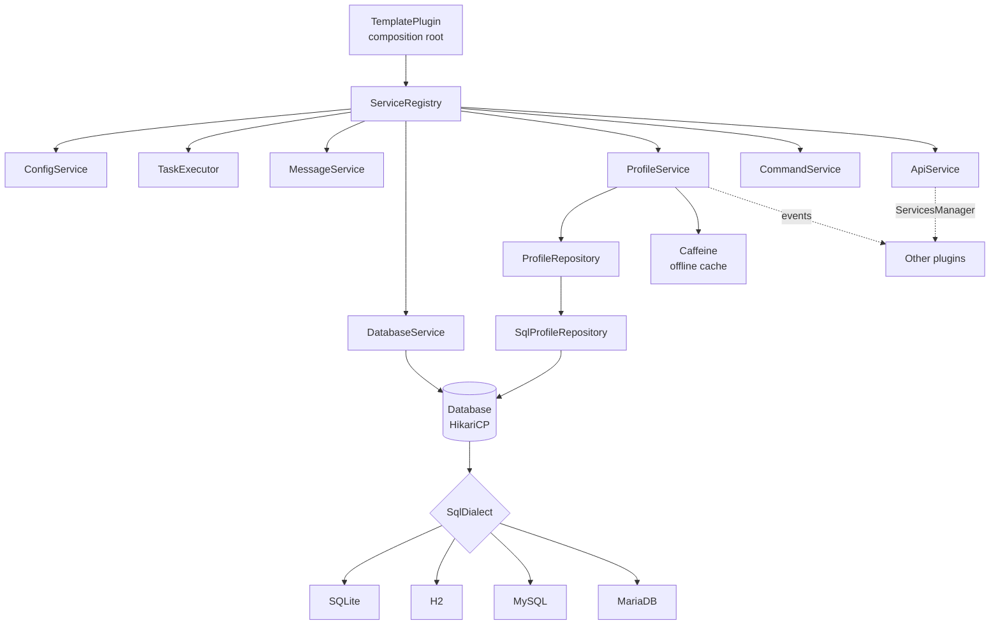

<div align="center">

# Paper Plugin Template

**A production-ready template for [Paper](https://papermc.io) 26.3 plugins on Java 25.**
Service-based architecture, async multi-database storage (SQLite · H2 · MySQL · MariaDB), versioned migrations,
a public API with events, MiniMessage messages, Lamp commands, tests and CI out of the box.


</div>

---

## Table of contents

1. [Why this template](#why-this-template)
2. [Requirements](#requirements)
3. [Quick start](#quick-start)
4. [Architecture](#architecture)
5. [Package layout](#package-layout)
6. [Service lifecycle](#service-lifecycle)
7. [Threading model](#threading-model)
8. [Storage](#storage)
9. [Concurrent and multi-process H2](#concurrent-and-multi-process-h2)
10. [Schema migrations](#schema-migrations)
11. [Player profiles](#player-profiles)
12. [Public API for other plugins](#public-api-for-other-plugins)
13. [Messages and localization](#messages-and-localization)
14. [Commands and permissions](#commands-and-permissions)
15. [Full configuration](#full-configuration)
16. [Libraries and rationale](#libraries-and-rationale)
17. [Build, tests and CI](#build-tests-and-ci)
18. [Recipes](#recipes)
19. [Renaming the template](#renaming-the-template)
20. [Updating versions](#updating-versions)
21. [Troubleshooting](#troubleshooting)
22. [What changed from the previous version](#what-changed-from-the-previous-version)
23. [License](#license)

---

## Why this template

| Common plugin problem | How the template solves it |
|---|---|
| SQL queries on the main thread causing lag | Profiles load during `AsyncPlayerPreLoginEvent` and saves run on virtual threads: the server thread never touches the database. |
| Data lost on restart or Ctrl+C | Periodic autosave of modified profiles only, save on quit, synchronous flush in `onDisable`, and the async executor is drained before the pool closes. |
| `Database may be already in use` with H2 | Auto-server mode: several processes write to the same file at the same time. Tested with 4 JVMs in parallel. |
| Database schema changing between releases | Versioned, transactional migrations tracked in `schema_history`. |
| Different SQL for every database | `SqlDialect` abstraction: driver, URL, pool tuning and upsert for each engine in a single class. |
| Monolithic, untestable plugins | Services with explicit constructors, no static singletons, storage behind an interface, tests against real databases. |
| Hardcoded messages or `&` color codes | `messages.yml` in MiniMessage, injection-safe placeholders, hot reload. |
| Huge jars bundling every dependency | Libraries are downloaded by Paper (`libraries` in `plugin.yml`, generated from the version catalog). Only Lamp is shaded, and it is relocated. |

---

## Requirements

| Tool | Version | Notes |
|---|---|---|
| Server | Paper 26.3 | `api-version` is generated from the version catalog |
| JDK to build | 25 | Downloaded automatically by Gradle (foojay) when missing |
| Gradle | 9.9.1 | Bundled through the wrapper, no install needed |

---

## Quick start

```bash
git clone https://github.com/imBuzz/Plugin-Template.git MyPlugin
cd MyPlugin

./scripts/rename.sh MyPlugin dev.myname.myplugin "MyName"   # package, classes, permissions, commands
./gradlew build                                             # compile + tests
./gradlew runServer                                         # dev Paper server with the plugin installed
```

Output in `build/libs/`:

| File | Contents |
|---|---|
| `MyPlugin-<version>.jar` | The plugin, drop it in `plugins/` |
| `MyPlugin-<version>-api.jar` | Only the `api` package, for other plugins that want to integrate |

---

## Architecture



Principles:

- **Single composition root.** Every dependency is created and wired in `TemplatePlugin#onEnable`. Reading that one method shows the whole object graph.
- **Constructor injection.** Each class receives what it needs through its constructor. No `getInstance()`, no mutable static fields.
- **Ports and adapters.** `ProfileRepository` is the port, `SqlProfileRepository` the adapter. A Redis or in-memory implementation can be swapped in without touching `ProfileService`.
- **Dialects.** Everything that differs between databases lives in `SqlDialect`. Adding an engine means writing one class and one enum constant.
- **API separated from implementation.** The `api` package contains only interfaces and events. Other plugins depend on it, never on internal classes.

---

## Package layout

One Gradle module, one `src` folder, one root package.

```
src/main/java/it/buzz/template
├── TemplatePlugin.java              composition root
│
├── api/                             PUBLIC CONTRACT (published as -api.jar)
│   ├── TemplateApi.java             entry point, TemplateApi.get()
│   ├── player/
│   │   ├── PlayerProfile.java       view of a player's profile
│   │   └── PlayerProfileService.java
│   └── event/
│       ├── PlayerProfileLoadEvent.java    async, on login
│       └── PlayerProfileUnloadEvent.java  sync, on quit
│
├── core/                            INFRASTRUCTURE
│   ├── api/ApiService.java          registers TemplateApi in the ServicesManager
│   ├── lifecycle/
│   │   ├── Service.java             enable / disable / reload
│   │   └── ServiceRegistry.java     ordering, rollback, reload
│   ├── concurrent/TaskExecutor.java virtual threads + hop back to the main thread
│   ├── config/
│   │   ├── ConfigService.java
│   │   ├── PluginConfig.java        config.yml schema
│   │   └── MessagesConfig.java      messages.yml schema
│   └── message/MessageService.java  MiniMessage + prefix + safe placeholders
│
├── storage/                         PERSISTENCE
│   ├── database/
│   │   ├── Database.java            HikariCP pool + migrations
│   │   ├── DatabaseService.java     Bukkit wrapper
│   │   ├── DatabaseSettings.java    immutable record, testable without a server
│   │   └── DatabaseType.java        enum -> SqlDialect
│   ├── dialect/
│   │   ├── SqlDialect.java
│   │   ├── SqliteDialect.java
│   │   ├── H2Dialect.java
│   │   ├── MySqlDialect.java
│   │   └── MariaDbDialect.java
│   └── migration/
│       ├── Migration.java
│       ├── MigrationRunner.java
│       └── Migrations.java          ordered list of migrations
│
├── profile/                         DOMAIN: PLAYER PROFILES
│   ├── ProfileData.java             PlayerProfile implementation
│   ├── ProfileSnapshot.java         immutable copy for the I/O thread
│   ├── ProfileCodec.java            JSON (Gson)
│   ├── ProfileRepository.java       storage port
│   ├── SqlProfileRepository.java    JDBC adapter
│   ├── ProfileService.java          online cache, autosave, offline lookup
│   └── ProfileListener.java         login / join / quit
│
└── command/                         COMMANDS
    ├── CommandService.java          Lamp registration
    ├── CommandErrorHandler.java     every error -> messages.yml
    └── TemplateCommand.java         /template info | reload | stats
```

---

## Service lifecycle

Every component implements `Service`:

```java
public interface Service {
    void enable() throws Exception;
    default void disable() throws Exception {}
    default void reload() throws Exception {}
}
```

`ServiceRegistry` guarantees:

| Phase | Behavior |
|---|---|
| `enableAll()` | Enables services **in registration order**. If one fails, those already started are disabled in reverse order and the plugin disables itself with a clear log. |
| `reloadAll()` | Called by `/template reload`, in startup order. |
| `disableAll()` | **Reverse order**. A service that throws never prevents the others from stopping. Calling it twice is a no-op. |

The registration order in `TemplatePlugin` is therefore also the dependency order: the database starts before profiles and stops after them, so the final save always finds the pool open.

---

## Threading model

```
 Server thread                         Virtual threads (TaskExecutor.async)
 ─────────────                         ────────────────────────────────────
 PlayerJoinEvent  ── recordJoin()
 autosave tick    ── snapshot() ─────▶ repository.saveAll(snapshots)
 PlayerQuitEvent  ── snapshot() ─────▶ repository.save(snapshot)
 /template stats  ── lookup() ───────▶ Caffeine ─▶ repository.findByName()
                  ◀──── thenAcceptAsync(..., executor.main()) ────┘
                                       AsyncPlayerPreLoginEvent (Paper thread)
                                         └─ repository.findOrCreate()
```

Rules:

1. Profiles are **mutated only on the server thread**.
2. Only **immutable `ProfileSnapshot`s**, serialized on the server thread, travel to the database. The I/O thread never reads mutable objects.
3. Blocking work goes through `TaskExecutor`, built on **virtual threads**. Unlike Bukkit's async scheduler, it is **drained on shutdown** (up to 15 seconds), so an in-flight save is never cut off.
4. To get back on the server thread: `future.thenAcceptAsync(result -> ..., executor.main())`.

---

## Storage

| Backend | When to use it | Concurrent writes | Multiple servers | Setup |
|---|---|---|---|---|
| `SQLITE` (default) | Single small/medium server | 1 writer, WAL | No | None, driver bundled with Paper |
| `H2` | Single server with heavy I/O, or several servers **on the same machine** | Yes, row-level MVCC | Yes, with `auto-server: true` | None, driver downloaded by Paper |
| `MYSQL` | Network spanning several machines | Yes | Yes | External database, driver bundled with Paper |
| `MARIADB` | Network spanning several machines | Yes | Yes | External database, driver downloaded by Paper |

Tuning applied by each dialect:

| Dialect | Settings |
|---|---|
| SQLite | Pool of 1 connection (no `SQLITE_BUSY`), `journal_mode=WAL`, `synchronous=NORMAL`, `busy_timeout=5000` |
| H2 | Configurable pool, `LOCK_TIMEOUT=10000`, `MAX_COMPACT_TIME=2000`, connection validation, see the H2 section |
| MySQL / MariaDB | Prepared statement cache, `rewriteBatchedStatements`, 60 s keepalive, 30 min max lifetime |

Upserts are atomic on every engine: `ON CONFLICT DO UPDATE` (SQLite), `MERGE INTO ... KEY` (H2), `ON DUPLICATE KEY UPDATE` (MySQL/MariaDB).

The table prefix (`database.table-prefix`) is validated with a regex, so it cannot be used for SQL injection. The password never appears in logs.

---

## Concurrent and multi-process H2

Embedded H2 has a few well-known pitfalls. Here is how the template handles them (`H2Dialect`):

| Problem | Cause | Fix |
|---|---|---|
| `Database may be already in use` | The file is locked by the first process that opens it | `AUTO_SERVER=TRUE`: the first process becomes the owner and serves the file over localhost; the others connect automatically. If the owner stops, another one takes over. |
| `Database is already closed` on shutdown | H2's shutdown hook closes the database **while** Paper is still disabling plugins (Ctrl+C, SIGTERM) | In single-process mode: `DB_CLOSE_ON_EXIT=FALSE` and the pool is closed explicitly in `onDisable`. |
| `Timeout trying to lock table` under load | Default timeout of 1 second | `LOCK_TIMEOUT=10000` |
| `.mv.db` file growing forever | No compaction | `MAX_COMPACT_TIME=2000` on close |
| `Implicit relative path` | H2 2.x rejects relative paths | Path normalized to absolute in `DatabaseSettings` |
| Serialized writes | Old PageStore engine | MVStore (default in H2 2.x) with MVCC and row-level locks: the pool uses several connections in parallel |

**The two modes**

```yaml
database:
  type: H2
  h2:
    auto-server: false   # single server: shutdown always safe, even on Ctrl+C
    auto-server-port: 0  # 0 = pick a free port automatically
```

- `auto-server: false` (default): maximum data safety for a single server.
- `auto-server: true`: several processes (two servers on the same machine, a web panel, the H2 console) read and write **the same file at the same time**. H2 does not allow combining this with `DB_CLOSE_ON_EXIT=FALSE`, so on a hard kill you can lose at most the changes made after the last autosave. A normal `/stop` is always safe.

Both promises are verified by `H2ConcurrencyTest`:

- `manyThreadsWriteInParallel`: 16 virtual threads × 200 upserts on the same database.
- `severalProcessesShareTheSameFile`: **3 child JVMs plus the test JVM** write to the same file in parallel; the final row count is exact.

> Two servers modifying **the same player** at the same moment follow last-write-wins. Networks where players move between servers need a locking or messaging layer (Redis, plugin messaging), which is out of scope for this template.

---

## Schema migrations

```java
public static final List<Migration> ALL = List.of(
    new Migration(1, "create players table", (connection, db) -> { ... }),
    new Migration(2, "add guilds table",     (connection, db) -> { ... })   // append new migrations
);
```

- On startup `MigrationRunner` creates `<prefix>schema_history`, reads the current version and applies only the missing migrations, **in order** and **each in its own transaction**.
- If a migration fails it is rolled back and the plugin does not start: no half-applied schema.
- A released migration must **never** be edited. Changes go into a new one.
- Use `db.table("name")` to respect the prefix, and `db.dialect()` when you need engine-specific SQL.

Initial schema:

```sql
CREATE TABLE <prefix>players (
    uuid       CHAR(36)    NOT NULL PRIMARY KEY,
    name       VARCHAR(16) NOT NULL,
    data       TEXT        NOT NULL,   -- profile JSON
    created_at BIGINT      NOT NULL,
    updated_at BIGINT      NOT NULL
);
CREATE INDEX idx_<prefix>players_name ON <prefix>players (name);
```

---

## Player profiles

Profile lifecycle:

| Moment | Thread | Action |
|---|---|---|
| `AsyncPlayerPreLoginEvent` (LOW) | async | `findOrCreate`, profile cached, `PlayerProfileLoadEvent` fired |
| `AsyncPlayerPreLoginEvent` (MONITOR) | async | If another plugin denied the login (ban, whitelist), the profile is discarded |
| `PlayerJoinEvent` | main | `joins++`, name and `lastSeen` updated |
| Autosave (every `autosave-interval-seconds`) | main → async | Snapshot of modified profiles only, saved in a single batch |
| `PlayerQuitEvent` | main → async | `PlayerProfileUnloadEvent`, snapshot, save, removal from cache |
| `onDisable` | main | Synchronous save of every online profile |

If loading fails (database unreachable) the player is kicked with a configurable message, instead of joining with empty data that would later overwrite the real data.

**Custom data.** The profile body is stored as JSON, so adding a field needs no migration:

```java
// ProfileData.java
private int coins;                     // default for existing profiles

public int coins() { return coins; }

public void addCoins(int amount) {
    coins += amount;
    markDirty();                       // saved on the next autosave / quit
}
```

Generic counters are already available through a fastutil map:

```java
profile.increment("kills", 1);
int kills = profile.counter("kills");
```

**Offline lookups.** `lookup(name)` checks online players first, then the database through a **Caffeine** cache (1000 entries, 1 minute). Concurrent requests for the same name result in **a single query**. The cache is invalidated when the player joins or quits, so it never returns stale data.

---

## Public API for other plugins

```java
TemplateApi api = TemplateApi.get();

PlayerProfile profile = api.profiles().get(player);
profile.increment("quests_completed", 1);

api.profiles().lookup("Notch").thenAccept(result ->
        result.ifPresent(p -> getLogger().info(p.name() + " joins: " + p.joins())));
```

Events:

```java
@EventHandler
public void onLoad(PlayerProfileLoadEvent event) {        // async, during login
    if (event.created()) {
        event.profile().increment("welcome_bonus", 100);
    }
}

@EventHandler
public void onUnload(PlayerProfileUnloadEvent event) {    // sync, before saving
    event.profile().increment("sessions", 1);             // will be persisted
}
```

Dependency for other plugins (after `./gradlew publishToMavenLocal`):

```kotlin
dependencies {
    compileOnly("it.buzz.template:plugintemplate-api:1.0.0-SNAPSHOT")
}
```

```yaml
# plugin.yml of the other plugin
depend: [PluginTemplate]
```

---

## Messages and localization

All text lives in `plugins/<Plugin>/messages.yml` and uses [MiniMessage](https://docs.advntr.dev/minimessage/format.html):

```yaml
prefix: '<gradient:#5e4fa2:#f79459>Template</gradient> <dark_gray>»</dark_gray> '
commands:
  reload:
    success: '<prefix><green>Configuration reloaded in <white><time></white> ms.'
```

- `<prefix>` is available in every message.
- Placeholders (`<time>`, `<player>`, ...) are inserted as **plain text**: a player named `<red><click:run_command:/op me>` cannot inject formatting or click events.
- An empty message (`''`) is not sent, so any line can be disabled.
- Missing keys are added automatically on startup; existing ones are never touched.
- `/template reload` reloads messages without a restart.

Every command framework error (missing argument, invalid number, unknown player, cooldown, ...) uses a key from the `errors` section.

---

## Commands and permissions

| Command | Alias | Permission | Description |
|---|---|---|---|
| `/template info` | `/tpl info` | `template.admin` | Version, storage, profiles in memory |
| `/template reload` | `/tpl reload` | `template.admin.reload` | Reloads `config.yml` and `messages.yml` |
| `/template stats [player]` | `/tpl stats` | `template.admin.stats` | A player's profile, even offline. Without an argument shows your own |

`template.admin` includes every sub-permission. Default: op.

Commands use [Lamp](https://github.com/Revxrsal/Lamp) with Brigadier support: suggestions, type validation and error messages come for free.

```java
@Command("homes")
public final class HomesCommand {

    @Subcommand("set")
    @CommandPermission("homes.set")
    public void set(Player sender, @Range(min = 1, max = 10) int slot) { ... }
}
```

Register it in `TemplatePlugin` by passing it to `CommandService`.

---

## Full configuration

`plugins/<Plugin>/config.yml` (generated on first start):

```yaml
# Prints extra diagnostic information to the console.
debug: false
# Database connection settings. Changes require a server restart.
database:
    # Storage backend:
    #   SQLITE  - local file, zero setup, one writer at a time. Good for small servers.
    #   H2      - local file, concurrent writers, can be shared by several servers on the same machine.
    #   MYSQL / MARIADB - remote database, shared by servers on any machine.
    type: SQLITE
    host: localhost
    port: 3306
    name: minecraft
    user: root
    password: ''
    h2:
        # H2 only. When true, several processes (e.g. two servers on the same machine, or the H2 console)
        # can open and write the same database file at the same time: the first one serves the others over localhost.
        # Leave false for a single server: shutdown is then guaranteed to flush everything even on Ctrl+C.
        auto-server: false
        # H2 only. TCP port used by the auto server; 0 picks a free port automatically.
        auto-server-port: 0
    # Prefix for every table created by this plugin. Letters, digits and underscores only.
    table-prefix: template_
    pool:
        # Maximum number of pooled connections (MYSQL, MARIADB, H2). SQLITE always uses 1.
        maximum-size: 10
        minimum-idle: 2
        connection-timeout-ms: 5000
player-data:
    # How often (in seconds) modified player data is flushed to the database. 0 disables autosave.
    autosave-interval-seconds: 300
```

---

## Libraries and rationale

| Library | Version | How it reaches the server | Why |
|---|---|---|---|
| [Paper API](https://jd.papermc.io/paper/) | 26.3 | Server | Already ships Adventure/MiniMessage, Gson, Guava and **fastutil**: use them without adding anything to the jar. |
| [Lamp](https://github.com/Revxrsal/Lamp) | 4.0.1 | Shaded and relocated | Annotation commands, Brigadier, custom types, replaceable error messages. |
| [ConfigMe](https://github.com/AuthMe/ConfigMe) | 1.4.1 | `libraries` | Typed configuration, comments, automatic insertion of missing keys. |
| [HikariCP](https://github.com/brettwooldridge/HikariCP) | 7.1.0 | `libraries` | The fastest and most reliable JDBC pool. |
| [H2](https://h2database.com) | 2.5.252 | `libraries` | File database with concurrent writes and multi-process mode. |
| [MariaDB Connector/J](https://mariadb.com/kb/en/about-mariadb-connector-j/) | 3.5.11 | `libraries` | MariaDB driver (SQLite and MySQL drivers are already bundled with Paper). |
| [Caffeine](https://github.com/ben-manes/caffeine) | 3.3.1 | `libraries` | High-performance cache: request coalescing, expiry, size bound. |
| [fastutil](https://fastutil.di.unimi.it) | 8.5.x | Server (Paper) | Primitive collections without boxing (`Object2IntOpenHashMap`, `Long2ObjectOpenHashMap`, ...). |

**When to use fastutil.** It pays off when keys or values are primitives: counters, chunk coordinates packed into a `long`, numeric IDs. It avoids boxing and reduces memory and GC pressure. It does not replace `ConcurrentHashMap` for data shared across threads, because its maps are not thread-safe: that is why the online player cache stays a `ConcurrentHashMap`, while profile counters (mutated only on the server thread) use `Object2IntOpenHashMap`.

```java
Long2ObjectOpenHashMap<ChunkData> chunks = new Long2ObjectOpenHashMap<>();
chunks.put(Chunk.getChunkKey(x, z), data);                // no boxed Long

Object2IntOpenHashMap<String> counters = new Object2IntOpenHashMap<>();
counters.addTo("kills", 1);                                // single lookup
```

**Why `libraries` instead of shading.** Paper downloads libraries once into `libraries/` and loads them in a classloader dedicated to the plugin. The jar stays around 500 KB, no relocation is needed and there are no conflicts with other plugins. The list in `plugin.yml` is generated from the version catalog, so there is a single source of truth for versions.

---

## Build, tests and CI

```bash
./gradlew build                # compiles with -Werror, runs tests, builds jar and api jar
./gradlew test                 # tests only
./gradlew runServer            # Paper 26.3 dev server in ./run
./gradlew publishToMavenLocal  # publishes the api jar to ~/.m2
```

Included tests (JUnit 6):

| Class | What it verifies |
|---|---|
| `ServiceRegistryTest` | Startup and shutdown order, rollback on failed startup, resilient shutdown |
| `DatabaseTypeTest` | Upsert SQL for every dialect, H2 URLs, prefix validation, password hidden from logs |
| `SqlProfileRepositoryTest` | Runs **twice, on SQLite and on H2**: creation, reload, rename, batch, fastutil counters, JSON compatibility, idempotent migrations |
| `H2ConcurrencyTest` | 16 parallel threads and **4 JVM processes** on the same H2 file |

GitHub Actions (`.github/workflows/build.yml`) builds and tests on every push and pull request, uploads the jar as an artifact and, on a `v*` tag, creates a release with the jars attached:

```bash
git tag v1.0.0 && git push --tags
```

---

## Recipes

**New service**

```java
public final class EconomyService implements Service {
    private final ProfileService profiles;
    public EconomyService(ProfileService profiles) { this.profiles = profiles; }
    @Override public void enable() { /* listeners, tasks, ... */ }
    @Override public void disable() { /* cleanup */ }
}
```

```java
// TemplatePlugin#onEnable, after its dependencies
services.register(new EconomyService(profiles));
```

**New table**: add a `Migration` with the next version, then write a repository modeled on `SqlProfileRepository` using `database.dialect().upsert(...)`.

**New storage backend** (Redis, Mongo, ...): implement `ProfileRepository` and pass it to `ProfileService`.

**New SQL database**: implement `SqlDialect` and add a constant to `DatabaseType`.

**Blocking work (HTTP, files, DB)**

```java
executor.supplyAsync(() -> httpClient.fetch(url))
        .thenAcceptAsync(result -> player.sendMessage(result), executor.main());
```

**New message**: add a `Property<String>` to `MessagesConfig` and call `messages.send(sender, KEY, arg("name", value))`.

---

## Renaming the template

```bash
./scripts/rename.sh SuperHomes dev.sam.superhomes Sam
```

The script (works on macOS and Linux):

- moves `it/buzz/template` to the new package, in both `main` and `test`;
- renames `TemplatePlugin`, `TemplateCommand`, `TemplateApi`;
- updates permissions (`superhomes.admin`), command (`/superhomes`) and table prefix;
- updates `group`, author, project name and `plugin.yml`.

---

## Updating versions

Everything lives in `gradle/libs.versions.toml`:

```toml
[versions]
java = "25"
paper = "26.3.build.249-stable"
minecraft = "26.3"
```

Changing `paper` and `minecraft` also updates `api-version` in `plugin.yml` and the server version used by `runServer`. Runtime libraries bumped here end up in the `libraries` list automatically.

---

## Troubleshooting

| Symptom | Fix |
|---|---|
| `Startup failed, disabling plugin` | Read the exception below it: usually wrong database credentials or host. The plugin never starts half-initialized. |
| `Your data could not be loaded` on login | The database is not responding. The player is blocked on purpose so real data is not overwritten. |
| `Database may be already in use` with H2 | Set `database.h2.auto-server: true`. |
| Port in use with H2 auto-server | Keep `auto-server-port: 0` or pick a free port. |
| Raw tags like `<red>` visible in chat | Invalid MiniMessage syntax in `messages.yml`: check that tags are closed properly. |
| Slow shutdown with many players | Expected: the final flush is synchronous so no data is lost. Lower `autosave-interval-seconds` to reduce the work. |

---

## What changed from the previous version

Bugs fixed:

| Bug | Effect |
|---|---|
| `loadit 1.2.2-SNAPSHOT` dependency available only in `mavenLocal` | The project did not compile on any other machine |
| `registerTypeHierarchyAdapter` given a `TypeAdapterFactory` | `IllegalArgumentException` while loading the main class: the plugin never started |
| The type adapter always wrote `null` | All player data was lost on every save |
| `INSERT` without the `data JSON NOT NULL` column | Every new player failed to be created |
| `jdbc:mysql://` URL with the MariaDB 3.x driver | The driver rejects the `mysql` scheme: no connection possible |
| Pool created in the constructor outside the `try` | Unreachable database = unhandled exception and `NullPointerException` in `onDisable` |
| Commands registered even after the database failed | Disabled plugin with commands still active |
| UUID concatenated into the query | Hand-built SQL instead of a bound parameter |
| Compiled against Paper 1.20.4 with `api-version: 1.21.4` | Mismatch between API and declared version |
| Empty `@Command("")`, `weekend_boost_data` table | Leftovers from another project |

Improvements: Paper 26.3, Java 25, Gradle 9.9 with Kotlin DSL and version catalog, service architecture, multi-database support through dialects, multi-process H2, migrations, async profiles with autosave, API and events, MiniMessage, Caffeine, fastutil, tests, CI and automatic releases, rename script.

---

## License

Released under the [MIT](LICENSE) license. You can use, modify, redistribute and sell it, including in commercial and closed-source projects. The only condition is keeping the copyright notice and license text in copies of the source code.

---

<div align="center">
Made by <a href="https://github.com/imBuzz">Buzz</a>
</div>
