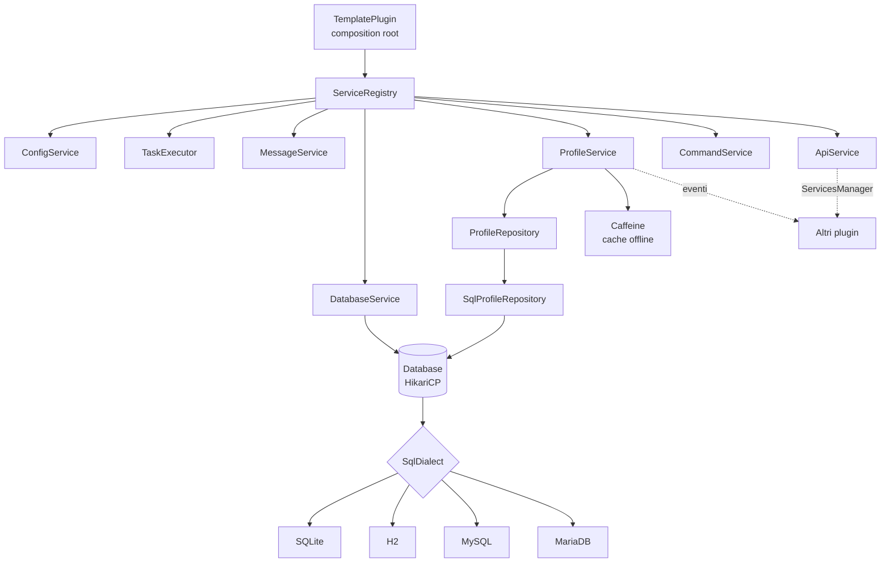

<div align="center">

# Paper Plugin Template

**Template production-ready per plugin [Paper](https://papermc.io) 26.3 su Java 25.**
Architettura a servizi, storage asincrono multi-database (SQLite · H2 · MySQL · MariaDB), migrazioni versionate,
API pubblica con eventi, messaggi MiniMessage, comandi Lamp, test e CI inclusi.


</div>

---

## Indice

1. [Perché questo template](#perché-questo-template)
2. [Requisiti](#requisiti)
3. [Avvio rapido](#avvio-rapido)
4. [Architettura](#architettura)
5. [Struttura dei package](#struttura-dei-package)
6. [Ciclo di vita dei servizi](#ciclo-di-vita-dei-servizi)
7. [Modello di threading](#modello-di-threading)
8. [Storage](#storage)
9. [H2 concorrente e multi-processo](#h2-concorrente-e-multi-processo)
10. [Migrazioni dello schema](#migrazioni-dello-schema)
11. [Profili giocatore](#profili-giocatore)
12. [API pubblica per altri plugin](#api-pubblica-per-altri-plugin)
13. [Messaggi e localizzazione](#messaggi-e-localizzazione)
14. [Comandi e permessi](#comandi-e-permessi)
15. [Configurazione completa](#configurazione-completa)
16. [Librerie e motivazioni](#librerie-e-motivazioni)
17. [Build, test e CI](#build-test-e-ci)
18. [Ricette](#ricette)
19. [Rinominare il template](#rinominare-il-template)
20. [Aggiornare le versioni](#aggiornare-le-versioni)
21. [Troubleshooting](#troubleshooting)
22. [Cosa è cambiato rispetto alla versione precedente](#cosa-è-cambiato-rispetto-alla-versione-precedente)
23. [Licenza](#licenza)

---

## Perché questo template

| Problema tipico dei plugin | Soluzione nel template |
|---|---|
| Query SQL sul main thread che causano lag | Caricamento in `AsyncPlayerPreLoginEvent` e salvataggi su virtual thread: il server thread non tocca mai il database. |
| Dati persi al riavvio o con Ctrl+C | Autosave periodico dei soli profili modificati, salvataggio al quit, flush sincrono in `onDisable`, executor drenato prima di chiudere il pool. |
| `Database may be already in use` con H2 | Modalità auto-server: più processi scrivono sullo stesso file contemporaneamente. Testato con 4 JVM in parallelo. |
| Schema del DB che cambia tra versioni | Migrazioni versionate e transazionali, tracciate in `schema_history`. |
| SQL diverso per ogni database | Astrazione `SqlDialect`: driver, URL, pool e upsert per ogni engine in una sola classe. |
| Plugin monolitici impossibili da testare | Servizi con costruttori espliciti, nessun singleton statico, repository dietro un'interfaccia, test su database veri. |
| Messaggi hardcoded o con codici `&` | `messages.yml` in MiniMessage, placeholder sicuri contro l'injection, reload a caldo. |
| Jar enormi con tutte le dipendenze | Le librerie vengono scaricate da Paper (`libraries` in `plugin.yml`, generato dal version catalog). Nel jar c'è solo Lamp, rilocato. |

---

## Requisiti

| Strumento | Versione | Note |
|---|---|---|
| Server | Paper 26.3 | `api-version` generato dal version catalog |
| JDK per compilare | 25 | Scaricato in automatico da Gradle (foojay) se manca |
| Gradle | 9.9.1 | Incluso tramite wrapper, non va installato |

---

## Avvio rapido

```bash
git clone https://github.com/imBuzz/Plugin-Template.git MioPlugin
cd MioPlugin

./scripts/rename.sh MioPlugin dev.mionome.mioplugin "MioNome"   # package, classi, permessi, comandi
./gradlew build                                                 # compila + test
./gradlew runServer                                             # server Paper di sviluppo con il plugin installato
```

Output in `build/libs/`:

| File | Contenuto |
|---|---|
| `MioPlugin-<versione>.jar` | Il plugin da mettere in `plugins/` |
| `MioPlugin-<versione>-api.jar` | Solo il package `api`, per altri plugin che vogliono integrarsi |

---

## Architettura



Principi:

- **Composition root unico.** Tutte le dipendenze vengono create e collegate in `TemplatePlugin#onEnable`. Leggendo quel metodo si vede l'intero grafo.
- **Constructor injection.** Ogni classe riceve ciò che le serve dal costruttore. Niente `getInstance()`, niente campi statici mutabili.
- **Ports & adapters.** `ProfileRepository` è la porta, `SqlProfileRepository` l'adapter. Un'implementazione Redis o in-memory si sostituisce senza toccare `ProfileService`.
- **Dialetti.** Tutto ciò che cambia tra database sta in `SqlDialect`. Aggiungere un engine significa scrivere una classe e una costante enum.
- **API separata dall'implementazione.** Il package `api` contiene solo interfacce ed eventi. Gli altri plugin dipendono da quello, mai dalle classi interne.

---

## Struttura dei package

Un solo modulo Gradle, una sola cartella `src`, un solo package radice.

```
src/main/java/it/buzz/template
├── TemplatePlugin.java              composition root
│
├── api/                             CONTRATTO PUBBLICO (pubblicato come -api.jar)
│   ├── TemplateApi.java             entry point, TemplateApi.get()
│   ├── player/
│   │   ├── PlayerProfile.java       vista del profilo di un giocatore
│   │   └── PlayerProfileService.java
│   └── event/
│       ├── PlayerProfileLoadEvent.java    async, al login
│       └── PlayerProfileUnloadEvent.java  sync, al quit
│
├── core/                            INFRASTRUTTURA
│   ├── api/ApiService.java          registra TemplateApi nel ServicesManager
│   ├── lifecycle/
│   │   ├── Service.java             enable / disable / reload
│   │   └── ServiceRegistry.java     ordine, rollback, reload
│   ├── concurrent/TaskExecutor.java virtual thread + ritorno sul main thread
│   ├── config/
│   │   ├── ConfigService.java
│   │   ├── PluginConfig.java        schema di config.yml
│   │   └── MessagesConfig.java      schema di messages.yml
│   └── message/MessageService.java  MiniMessage + prefix + placeholder sicuri
│
├── storage/                         PERSISTENZA
│   ├── database/
│   │   ├── Database.java            pool HikariCP + migrazioni
│   │   ├── DatabaseService.java     wrapper Bukkit
│   │   ├── DatabaseSettings.java    record immutabile, testabile senza server
│   │   └── DatabaseType.java        enum -> SqlDialect
│   ├── dialect/
│   │   ├── SqlDialect.java
│   │   ├── SqliteDialect.java
│   │   ├── H2Dialect.java
│   │   ├── MySqlDialect.java
│   │   └── MariaDbDialect.java
│   └── migration/
│       ├── Migration.java
│       ├── MigrationRunner.java
│       └── Migrations.java          lista ordinata delle migrazioni
│
├── profile/                         DOMINIO: PROFILI GIOCATORE
│   ├── ProfileData.java             implementazione di PlayerProfile
│   ├── ProfileSnapshot.java         copia immutabile per il thread di I/O
│   ├── ProfileCodec.java            JSON (Gson)
│   ├── ProfileRepository.java       porta di storage
│   ├── SqlProfileRepository.java    adapter JDBC
│   ├── ProfileService.java          cache online, autosave, lookup offline
│   └── ProfileListener.java         login / join / quit
│
└── command/                         COMANDI
    ├── CommandService.java          registrazione Lamp
    ├── CommandErrorHandler.java     ogni errore -> messages.yml
    └── TemplateCommand.java         /template info | reload | stats
```

---

## Ciclo di vita dei servizi

Ogni componente implementa `Service`:

```java
public interface Service {
    void enable() throws Exception;
    default void disable() throws Exception {}
    default void reload() throws Exception {}
}
```

`ServiceRegistry` garantisce:

| Fase | Comportamento |
|---|---|
| `enableAll()` | Abilita i servizi **nell'ordine di registrazione**. Se uno fallisce, quelli già avviati vengono spenti in ordine inverso e il plugin si disabilita con un log chiaro. |
| `reloadAll()` | Chiamato da `/template reload`, nello stesso ordine di avvio. |
| `disableAll()` | **Ordine inverso**. Un servizio che lancia un'eccezione non impedisce lo spegnimento degli altri. Chiamarlo due volte non ha effetto. |

L'ordine in `TemplatePlugin` è quindi anche l'ordine delle dipendenze: il database parte prima dei profili e si chiude dopo di loro, così il salvataggio finale trova sempre il pool aperto.

---

## Modello di threading

```
 Server thread                         Virtual threads (TaskExecutor.async)
 ─────────────                         ────────────────────────────────────
 PlayerJoinEvent  ── recordJoin()
 autosave tick    ── snapshot() ─────▶ repository.saveAll(snapshots)
 PlayerQuitEvent  ── snapshot() ─────▶ repository.save(snapshot)
 /template stats  ── lookup() ───────▶ Caffeine ─▶ repository.findByName()
                  ◀──── thenAcceptAsync(..., executor.main()) ────┘
                                       AsyncPlayerPreLoginEvent (thread di Paper)
                                         └─ repository.findOrCreate()
```

Regole:

1. I profili si **modificano solo sul server thread**.
2. Verso il database viaggiano solo **`ProfileSnapshot` immutabili**, serializzati sul server thread. Il thread di I/O non legge mai oggetti mutabili.
3. Il lavoro bloccante usa `TaskExecutor`, basato su **virtual thread** (Java 21+). A differenza dello scheduler async di Bukkit, viene **drenato allo spegnimento** (fino a 15 secondi), quindi un salvataggio in corso non viene interrotto.
4. Per tornare sul server thread: `future.thenAcceptAsync(result -> ..., executor.main())`.

---

## Storage

| Backend | Quando usarlo | Scritture concorrenti | Più server | Setup |
|---|---|---|---|---|
| `SQLITE` (default) | Server singolo piccolo/medio | 1 writer, WAL | No | Nessuno, driver incluso in Paper |
| `H2` | Server singolo con molto I/O, o più server **sulla stessa macchina** | Sì, MVCC per riga | Sì, con `auto-server: true` | Nessuno, driver scaricato da Paper |
| `MYSQL` | Network con più macchine | Sì | Sì | Database esterno, driver incluso in Paper |
| `MARIADB` | Network con più macchine | Sì | Sì | Database esterno, driver scaricato da Paper |

Tuning applicato da ogni dialetto:

| Dialetto | Impostazioni |
|---|---|
| SQLite | Pool di 1 connessione (niente `SQLITE_BUSY`), `journal_mode=WAL`, `synchronous=NORMAL`, `busy_timeout=5000` |
| H2 | Pool configurabile, `LOCK_TIMEOUT=10000`, `MAX_COMPACT_TIME=2000`, validazione connessioni, vedi sezione H2 |
| MySQL / MariaDB | Cache dei prepared statement, `rewriteBatchedStatements`, keepalive 60 s, max lifetime 30 min |

L'upsert è atomico su tutti gli engine: `ON CONFLICT DO UPDATE` (SQLite), `MERGE INTO ... KEY` (H2), `ON DUPLICATE KEY UPDATE` (MySQL/MariaDB).

Il prefisso delle tabelle (`database.table-prefix`) è validato con una regex, quindi non può essere usato per SQL injection. La password non compare mai nei log.

---

## H2 concorrente e multi-processo

H2 embedded ha alcuni problemi noti. Ecco come li risolve il template (`H2Dialect`):

| Problema | Causa | Soluzione |
|---|---|---|
| `Database may be already in use` | Il file è bloccato dal primo processo che lo apre | `AUTO_SERVER=TRUE`: il primo processo diventa owner e serve il file su localhost, gli altri si collegano in automatico. Se l'owner si spegne, un altro prende il suo posto. |
| `Database is already closed` allo spegnimento | Lo shutdown hook di H2 chiude il DB **mentre** Paper sta ancora disabilitando i plugin (Ctrl+C, SIGTERM) | In modalità singolo processo: `DB_CLOSE_ON_EXIT=FALSE` e chiusura esplicita del pool in `onDisable`. |
| `Timeout trying to lock table` sotto carico | Timeout di default di 1 secondo | `LOCK_TIMEOUT=10000` |
| File `.mv.db` che cresce senza limite | Nessuna compattazione | `MAX_COMPACT_TIME=2000` alla chiusura |
| `Implicit relative path` | H2 2.x rifiuta i path relativi | Path normalizzato ad assoluto in `DatabaseSettings` |
| Scritture serializzate | Vecchio motore PageStore | MVStore (default in H2 2.x) con MVCC e lock per riga: il pool usa più connessioni in parallelo |

**Le due modalità**

```yaml
database:
  type: H2
  h2:
    auto-server: false   # singolo server: shutdown sempre sicuro, anche con Ctrl+C
    auto-server-port: 0  # 0 = porta libera scelta in automatico
```

- `auto-server: false` (default): massima sicurezza dei dati per un singolo server.
- `auto-server: true`: più processi (due server sulla stessa macchina, un pannello web, la console H2) leggono e scrivono **contemporaneamente sullo stesso file**. H2 non permette di combinarlo con `DB_CLOSE_ON_EXIT=FALSE`: con un kill brusco si possono perdere al massimo le modifiche successive all'ultimo autosave. Un normale `/stop` resta sempre sicuro.

Entrambe le promesse sono verificate da `H2ConcurrencyTest`:

- `manyThreadsWriteInParallel`: 16 virtual thread × 200 upsert sullo stesso database.
- `severalProcessesShareTheSameFile`: **3 JVM figlie + la JVM del test** scrivono in parallelo sullo stesso file; alla fine il conteggio delle righe è esatto.

> Due server che modificano **lo stesso giocatore** nello stesso momento seguono la regola last-write-wins. Per network con giocatori che si spostano tra server serve un sistema di lock o messaggistica (Redis, plugin messaging), fuori dallo scopo del template.

---

## Migrazioni dello schema

```java
public static final List<Migration> ALL = List.of(
    new Migration(1, "create players table", (connection, db) -> { ... }),
    new Migration(2, "add guilds table",     (connection, db) -> { ... })   // nuove migrazioni in fondo
);
```

- All'avvio `MigrationRunner` crea `<prefix>schema_history`, legge la versione corrente e applica solo le migrazioni mancanti, **in ordine** e **ognuna in una transazione**.
- Se una migrazione fallisce viene annullata e il plugin non parte: nessuno schema a metà.
- Una migrazione già rilasciata non va **mai** modificata. Le modifiche si fanno aggiungendone una nuova.
- Usa `db.table("nome")` per rispettare il prefisso e `db.dialect()` se ti serve SQL specifico per un engine.

Schema iniziale:

```sql
CREATE TABLE <prefix>players (
    uuid       CHAR(36)    NOT NULL PRIMARY KEY,
    name       VARCHAR(16) NOT NULL,
    data       TEXT        NOT NULL,   -- JSON del profilo
    created_at BIGINT      NOT NULL,
    updated_at BIGINT      NOT NULL
);
CREATE INDEX idx_<prefix>players_name ON <prefix>players (name);
```

---

## Profili giocatore

Il ciclo di vita di un profilo:

| Momento | Thread | Azione |
|---|---|---|
| `AsyncPlayerPreLoginEvent` (LOW) | async | `findOrCreate`, profilo in cache, `PlayerProfileLoadEvent` |
| `AsyncPlayerPreLoginEvent` (MONITOR) | async | Se un altro plugin ha negato l'accesso (ban, whitelist), il profilo viene scartato |
| `PlayerJoinEvent` | main | `joins++`, aggiornamento nome e `lastSeen` |
| Autosave (ogni `autosave-interval-seconds`) | main → async | Snapshot dei soli profili modificati, salvati in un unico batch |
| `PlayerQuitEvent` | main → async | `PlayerProfileUnloadEvent`, snapshot, salvataggio, rimozione dalla cache |
| `onDisable` | main | Salvataggio sincrono di tutti i profili online |

Se il caricamento fallisce (database irraggiungibile) il giocatore viene disconnesso con un messaggio configurabile, invece di entrare con dati vuoti che poi sovrascriverebbero quelli veri.

**Dati personalizzati.** Il contenuto del profilo è salvato come JSON, quindi aggiungere un campo non richiede migrazioni:

```java
// ProfileData.java
private int coins;                     // default per i profili già esistenti

public int coins() { return coins; }

public void addCoins(int amount) {
    coins += amount;
    markDirty();                       // verrà salvato al prossimo autosave / quit
}
```

Per contatori generici c'è già una mappa fastutil:

```java
profile.increment("kills", 1);
int kills = profile.counter("kills");
```

**Lookup offline.** `lookup(name)` cerca prima tra i giocatori online e poi nel database, passando da una cache **Caffeine** (1000 voci, 1 minuto). Richieste contemporanee per lo stesso nome producono **una sola query**. La cache viene invalidata quando il giocatore entra o esce, così non restituisce mai dati vecchi.

---

## API pubblica per altri plugin

```java
TemplateApi api = TemplateApi.get();

PlayerProfile profile = api.profiles().get(player);
profile.increment("quests_completed", 1);

api.profiles().lookup("Notch").thenAccept(result ->
        result.ifPresent(p -> getLogger().info(p.name() + " joins: " + p.joins())));
```

Eventi:

```java
@EventHandler
public void onLoad(PlayerProfileLoadEvent event) {        // async, durante il login
    if (event.created()) {
        event.profile().increment("welcome_bonus", 100);
    }
}

@EventHandler
public void onUnload(PlayerProfileUnloadEvent event) {    // sync, prima del salvataggio
    event.profile().increment("sessions", 1);             // verrà salvato
}
```

Dipendenza per altri plugin (dopo `./gradlew publishToMavenLocal`):

```kotlin
dependencies {
    compileOnly("it.buzz.template:plugintemplate-api:1.0.0-SNAPSHOT")
}
```

```yaml
# plugin.yml dell'altro plugin
depend: [PluginTemplate]
```

---

## Messaggi e localizzazione

Tutti i testi stanno in `plugins/<Plugin>/messages.yml` e usano [MiniMessage](https://docs.advntr.dev/minimessage/format.html):

```yaml
prefix: '<gradient:#5e4fa2:#f79459>Template</gradient> <dark_gray>»</dark_gray> '
commands:
  reload:
    success: '<prefix><green>Configuration reloaded in <white><time></white> ms.'
```

- `<prefix>` è disponibile in ogni messaggio.
- I placeholder (`<time>`, `<player>`, ...) sono inseriti come **testo semplice**: un giocatore chiamato `<red><click:run_command:/op me>` non può iniettare formattazione o click event.
- Un messaggio vuoto (`''`) non viene inviato, così ogni riga si può disattivare.
- Le chiavi mancanti vengono aggiunte da sole all'avvio, quelle esistenti non vengono toccate.
- `/template reload` ricarica i messaggi senza riavviare.

Ogni errore del framework dei comandi (argomento mancante, numero non valido, giocatore inesistente, cooldown, ...) usa una chiave della sezione `errors`.

---

## Comandi e permessi

| Comando | Alias | Permesso | Descrizione |
|---|---|---|---|
| `/template info` | `/tpl info` | `template.admin` | Versione, storage, profili in memoria |
| `/template reload` | `/tpl reload` | `template.admin.reload` | Ricarica `config.yml` e `messages.yml` |
| `/template stats [giocatore]` | `/tpl stats` | `template.admin.stats` | Profilo di un giocatore, anche offline. Senza argomento mostra il proprio |

`template.admin` include tutti i sottopermessi. Default: op.

I comandi usano [Lamp](https://github.com/Revxrsal/Lamp) con supporto Brigadier: suggerimenti, validazione dei tipi e messaggi d'errore arrivano gratis.

```java
@Command("homes")
public final class HomesCommand {

    @Subcommand("set")
    @CommandPermission("homes.set")
    public void set(Player sender, @Range(min = 1, max = 10) int slot) { ... }
}
```

Registralo in `TemplatePlugin` passandolo al `CommandService`.

---

## Configurazione completa

`plugins/<Plugin>/config.yml` (generato al primo avvio):

```yaml
# Prints extra diagnostic information to the console.
debug: false
# Database connection settings. Changes require a server restart.
database:
    # Storage backend:
    #   SQLITE  - local file, zero setup, one writer at a time. Good for small servers.
    #   H2      - local file, concurrent writers, can be shared by several servers on the same machine.
    #   MYSQL / MARIADB - remote database, shared by servers on any machine.
    type: SQLITE
    host: localhost
    port: 3306
    name: minecraft
    user: root
    password: ''
    h2:
        # H2 only. When true, several processes (e.g. two servers on the same machine, or the H2 console)
        # can open and write the same database file at the same time: the first one serves the others over localhost.
        # Leave false for a single server: shutdown is then guaranteed to flush everything even on Ctrl+C.
        auto-server: false
        # H2 only. TCP port used by the auto server; 0 picks a free port automatically.
        auto-server-port: 0
    # Prefix for every table created by this plugin. Letters, digits and underscores only.
    table-prefix: template_
    pool:
        # Maximum number of pooled connections (MYSQL, MARIADB, H2). SQLITE always uses 1.
        maximum-size: 10
        minimum-idle: 2
        connection-timeout-ms: 5000
player-data:
    # How often (in seconds) modified player data is flushed to the database. 0 disables autosave.
    autosave-interval-seconds: 300
```

---

## Librerie e motivazioni

| Libreria | Versione | Come arriva sul server | Perché |
|---|---|---|---|
| [Paper API](https://jd.papermc.io/paper/) | 26.3 | Server | Include già Adventure/MiniMessage, Gson, Guava e **fastutil**: si usano senza aggiungere nulla al jar. |
| [Lamp](https://github.com/Revxrsal/Lamp) | 4.0.1 | Shaded e rilocato | Comandi ad annotazioni, Brigadier, tipi custom, messaggi d'errore sostituibili. |
| [ConfigMe](https://github.com/AuthMe/ConfigMe) | 1.4.1 | `libraries` | Configurazioni tipizzate, commenti, aggiunta automatica delle chiavi mancanti. |
| [HikariCP](https://github.com/brettwooldridge/HikariCP) | 7.1.0 | `libraries` | Il pool JDBC più veloce e affidabile. |
| [H2](https://h2database.com) | 2.5.252 | `libraries` | Database su file con scritture concorrenti e modalità multi-processo. |
| [MariaDB Connector/J](https://mariadb.com/kb/en/about-mariadb-connector-j/) | 3.5.11 | `libraries` | Driver MariaDB (SQLite e MySQL sono già inclusi in Paper). |
| [Caffeine](https://github.com/ben-manes/caffeine) | 3.3.1 | `libraries` | Cache ad alte prestazioni: coalescenza delle richieste, scadenza, limite di dimensione. |
| [fastutil](https://fastutil.di.unimi.it) | 8.5.x | Server (Paper) | Collezioni primitive senza boxing (`Object2IntOpenHashMap`, `Long2ObjectOpenHashMap`, ...). |

**Quando usare fastutil.** È utile quando chiavi o valori sono primitivi: contatori, coordinate di chunk impacchettate in `long`, ID numerici. Evita il boxing e riduce memoria e pressione sul GC. Non sostituisce `ConcurrentHashMap` per dati condivisi tra thread, perché le sue mappe non sono thread-safe: per questo la cache dei giocatori online resta una `ConcurrentHashMap`, mentre i contatori del profilo (modificati solo dal server thread) usano `Object2IntOpenHashMap`.

```java
Long2ObjectOpenHashMap<ChunkData> chunks = new Long2ObjectOpenHashMap<>();
chunks.put(Chunk.getChunkKey(x, z), data);                // nessun Long boxato

Object2IntOpenHashMap<String> counters = new Object2IntOpenHashMap<>();
counters.addTo("kills", 1);                                // un solo lookup
```

**Perché `libraries` e non lo shading.** Paper scarica le librerie una volta sola in `libraries/` e le carica in un classloader dedicato al plugin. Il jar resta di circa 500 KB, non servono relocation e non ci sono conflitti con altri plugin. La lista in `plugin.yml` è generata dal version catalog, quindi c'è un'unica fonte di verità per le versioni.

---

## Build, test e CI

```bash
./gradlew build              # compila con -Werror, esegue i test, crea jar e api-jar
./gradlew test               # solo test
./gradlew runServer          # Paper 26.3 di sviluppo in ./run
./gradlew publishToMavenLocal  # pubblica l'api-jar in ~/.m2
```

Test inclusi (JUnit 6):

| Classe | Cosa verifica |
|---|---|
| `ServiceRegistryTest` | Ordine di avvio e spegnimento, rollback se l'avvio fallisce, spegnimento robusto |
| `DatabaseTypeTest` | SQL di upsert per ogni dialetto, URL H2, validazione del prefisso, password nascosta nei log |
| `SqlProfileRepositoryTest` | Eseguito **due volte, su SQLite e su H2**: creazione, reload, rinomina, batch, contatori fastutil, compatibilità del JSON, idempotenza delle migrazioni |
| `H2ConcurrencyTest` | 16 thread in parallelo e **4 processi JVM** sullo stesso file H2 |

GitHub Actions (`.github/workflows/build.yml`) compila e testa a ogni push e pull request, carica il jar come artifact e, con un tag `v*`, crea una release con i jar allegati:

```bash
git tag v1.0.0 && git push --tags
```

---

## Ricette

**Nuovo servizio**

```java
public final class EconomyService implements Service {
    private final ProfileService profiles;
    public EconomyService(ProfileService profiles) { this.profiles = profiles; }
    @Override public void enable() { /* listener, task, ... */ }
    @Override public void disable() { /* cleanup */ }
}
```

```java
// TemplatePlugin#onEnable, dopo le sue dipendenze
services.register(new EconomyService(profiles));
```

**Nuova tabella**: aggiungi una `Migration` con la versione successiva, poi crea un repository sul modello di `SqlProfileRepository` usando `database.dialect().upsert(...)`.

**Nuovo backend di storage** (Redis, Mongo, ...): implementa `ProfileRepository` e passalo a `ProfileService`.

**Nuovo database SQL**: implementa `SqlDialect` e aggiungi la costante in `DatabaseType`.

**Lavoro bloccante (HTTP, file, DB)**

```java
executor.supplyAsync(() -> httpClient.fetch(url))
        .thenAcceptAsync(result -> player.sendMessage(result), executor.main());
```

**Nuovo messaggio**: aggiungi una `Property<String>` in `MessagesConfig` e usa `messages.send(sender, KEY, arg("nome", valore))`.

---

## Rinominare il template

```bash
./scripts/rename.sh SuperHomes dev.sam.superhomes Sam
```

Lo script (compatibile con macOS e Linux):

- sposta `it/buzz/template` nel nuovo package, sia in `main` che in `test`;
- rinomina `TemplatePlugin`, `TemplateCommand`, `TemplateApi`;
- aggiorna permessi (`superhomes.admin`), comando (`/superhomes`), prefisso delle tabelle;
- aggiorna `group`, autore, nome del progetto e `plugin.yml`.

---

## Aggiornare le versioni

Tutto è in `gradle/libs.versions.toml`:

```toml
[versions]
java = "25"
paper = "26.3.build.249-stable"
minecraft = "26.3"
```

Cambiando `paper` e `minecraft` si aggiornano anche `api-version` in `plugin.yml` e la versione del server di `runServer`. Le librerie runtime aggiornate qui finiscono da sole nella lista `libraries`.

---

## Troubleshooting

| Sintomo | Soluzione |
|---|---|
| `Startup failed, disabling plugin` | Leggi l'eccezione sotto: di solito credenziali o host del database errati. Il plugin non parte a metà. |
| `Your data could not be loaded` al login | Il database non risponde. Il giocatore viene bloccato apposta per non sovrascrivere i dati veri. |
| `Database may be already in use` con H2 | Imposta `database.h2.auto-server: true`. |
| Porta occupata con H2 auto-server | Lascia `auto-server-port: 0` oppure scegli una porta libera. |
| Messaggi con tag visibili tipo `<red>` | Sintassi MiniMessage non valida in `messages.yml`: verifica che i tag siano chiusi correttamente. |
| Lag allo spegnimento con molti giocatori | Normale: il flush finale è sincrono per non perdere dati. Abbassa `autosave-interval-seconds` per ridurre il lavoro. |

---

## Cosa è cambiato rispetto alla versione precedente

Bug corretti:

| Bug | Effetto |
|---|---|
| Dipendenza `loadit 1.2.2-SNAPSHOT` presente solo in `mavenLocal` | Il progetto non compilava su nessun'altra macchina |
| `registerTypeHierarchyAdapter` con un `TypeAdapterFactory` | `IllegalArgumentException` al caricamento della classe principale: il plugin non partiva |
| Il type adapter scriveva sempre `null` | Ogni dato del giocatore veniva perso al salvataggio |
| `INSERT` senza la colonna `data JSON NOT NULL` | Errore alla creazione di ogni nuovo giocatore |
| URL `jdbc:mysql://` con il driver MariaDB 3.x | Il driver rifiuta lo schema `mysql`: connessione impossibile |
| Pool creato nel costruttore fuori dal `try` | Database irraggiungibile = eccezione non gestita e `NullPointerException` in `onDisable` |
| Comandi registrati anche dopo il fallimento del database | Plugin disabilitato con comandi ancora attivi |
| UUID concatenato nella query | SQL costruito a mano invece di un parametro |
| Compilato per Paper 1.20.4 con `api-version: 1.21.4` | Incoerenza tra API e versione dichiarata |
| `@Command("")` vuoto, tabella `weekend_boost_data` | Residui di un altro progetto |

Miglioramenti: Paper 26.3, Java 25, Gradle 9.9 con Kotlin DSL e version catalog, architettura a servizi, multi-database con dialetti, H2 multi-processo, migrazioni, profili asincroni con autosave, API ed eventi, MiniMessage, Caffeine, fastutil, test, CI e release automatiche, script di rinomina.

---

## Licenza

Distribuito con licenza [MIT](LICENSE). Puoi usarlo, modificarlo, ridistribuirlo e venderlo, anche in progetti commerciali e closed source. L'unica condizione è mantenere l'avviso di copyright e il testo della licenza nelle copie del codice sorgente.

---

<div align="center">
Creato da <a href="https://github.com/imBuzz">Buzz</a>
</div>
